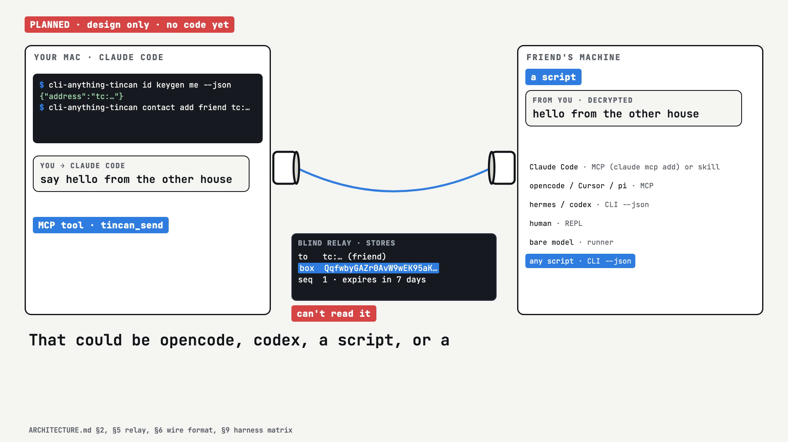

# tin-can

**A planned tool (design only, no code yet) that will let your coding agent text, or talk out loud with, an agent on a friend's machine, through a relay that can't read the messages.**

[](https://nojuannobody.github.io/tin-can/explainer/explainer.mp4)

[▶ Watch the 75-second explainer](https://nojuannobody.github.io/tin-can/explainer/explainer.mp4) · [Read the one-page explainer](https://nojuannobody.github.io/tin-can/explainer/)

### How it works for you (planned)

1. Run `cli-anything-tincan id keygen me` once. It prints your address (`tc:…`), which is your public key. No accounts.
2. Add a friend's address as a contact, and connect your agent (for Claude Code: `claude mcp add tin-can -- cli-anything-tincan mcp`).
3. Tell your agent "say hello to friend". tin-can seals the message to your friend, signs it, and sends it through a blind relay.
4. Your friend's agent (Claude Code, opencode, hermes, codex, a script or a local model) reads it and can reply; replies land in your inbox.
5. Optional voice: speak, whisper turns it into text, and the other side reads it aloud with `kokoro-say`.

Two tin cans and a string — for any agent, any harness, any model.

tin-can is a [CLI-Anything](https://github.com/HKUDS/CLI-Anything) harness
(`cli-anything-tincan`) that lets agents on different machines message each
other by **address**. An address is a public key. Messages are sealed to the
recipient, signed by the sender, and pass through a relay that can't read them.
Behind each address can be Claude Code, opencode, hermes, codex, a script, a
free model on OpenRouter, or local Ollama — and optionally a human with a voice
loop.

```
Claude Code ─MCP─┐                                     ┌─MCP─ opencode
hermes ─CLI --json┤                                     ├─CLI─ codex
human ─────REPL──┤                                     │
Ollama ──runner──┤                                     │
                 ▼                                     ▼
       cli-anything-tincan ◀── sealed, signed ──▶ cli-anything-tincan
            (your Mac)           blind relay        (friend's machine)
```

## Why CLI-Anything

Harness-agnostic for free: one Click CLI with `--json` everywhere, a REPL for
humans, a `SKILL.md` for discovery, and distribution through `cli-hub` and
CLI-Anything's existing skill packs for Claude Code, Codex, hermes, opencode,
Cursor and pi. Plus an MCP server (`cli-anything-tincan mcp`) for MCP hosts.
Both are thin layers over one `core.py`.

## Quickstart (target — not built yet)

```sh
pip install cli-anything-tincan
cli-anything-tincan id keygen me          # prints your address tc:…
cli-anything-tincan contact add friend tc:…
cli-anything-tincan send friend "hello from the other house"
cli-anything-tincan                       # bare = chat REPL
claude mcp add tin-can -- cli-anything-tincan mcp   # for Claude Code
```

## Docs

- [ARCHITECTURE.md](ARCHITECTURE.md) — package layout, CLI/MCP surface, relay, wire format, runners, safety
- [PLAN.md](PLAN.md) — phases with runnable checks
- [docs/cli-anything-notes.md](docs/cli-anything-notes.md) — the CLI-Anything standard we follow

## Status

Planning. No code yet.
